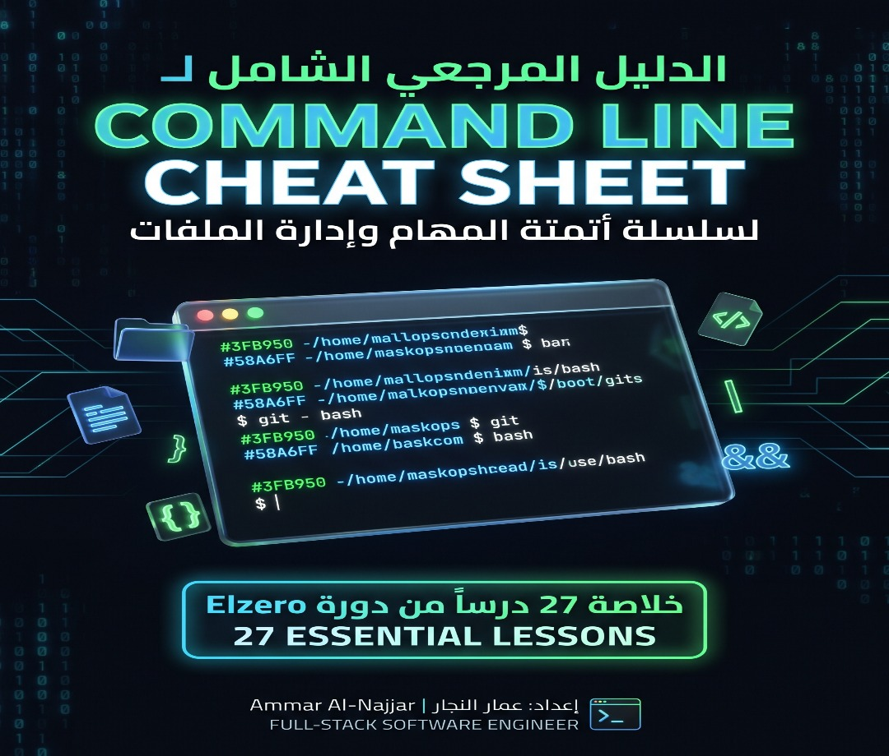

<div align="center">

# 💻 الدليل المرجعي الشامل لسطر الأوامر | CLI Cheat Sheet

**مرجع عملي منظّم، احترافي، ومفتوح المصدر لسطر الأوامر وـ Bash Scripting**
<br />
<sub>مستخلص ومطوّر من دورة <b>Learn Command Line (27 درساً)</b> للمهندس <b>أسامة الزيرو</b> — Elzero Web School</sub>

<br /><br />

[](scripts/)
[](https://youtube.com/playlist?list=PLPekubhUiZ90&si=1bbD5L14yWCst9_q)
[](scripts/)
[](docs/Carousel_Command_Line_Interface.pdf)
[](LICENSE)
[](https://github.com/Ammar-1993)

<br />

[📑 فهرس المحتويات](#-فهرس-المحتويات) •
[🧭 مسار التعلم](#-مسار-التعلم-roadmap) •
[🤖 السكربتات التطبيقية](#-8-سكربتات-الدورة-التطبيقية-bash-scripts) •
[📄 النسخة المصوّرة PDF](docs/Carousel_Command_Line_Interface.pdf) •
[🚀 التشغيل السريع](#-10-هيكل-المستودع-وطريقة-التشغيل)

<br />

<a href="docs/Carousel_Command_Line_Interface.pdf" title="اضغط لتحميل أو فتح النسخة المصورة PDF">
  
</a>
<br />
<sub>👆 <b>اضغط على الصورة</b> لتحميل أو تصفّح الدليل البصري كاملاً (8 شرائح عالية الدقة مخصصة للمراجعة السريعة)</sub>

<br /><br />

</div>

---

### 🌟 مميزات هذا المرجع

|                     📱 **ملخص بصري (Carousel)**                     |                  🛡️ **هندسة برمجية آمنة**                  |              ⚙️ **سكربتات أتمتة متقدمة**               |                     🎓 **تغطية شاملة 100%**                      |
| :-----------------------------------------------------------------: | :--------------------------------------------------------: | :----------------------------------------------------: | :--------------------------------------------------------------: |
| تصميم داكن بنمط Terminal مكوّن من 8 شرائح للمراجعة السريعة والطباعة | تنبيهات للحذف غير القابل للاسترجاع وفحص المسافات والمدخلات | كود Bash تفاعلي مزوّد بألوان ANSI وقوالب HTML5 متكاملة | ملخص لجميع محاور دورة الزيرو (27 درساً) مع أوامر التوسع المتقدمة |

---

### 🧭 مسار التعلم (Roadmap)


---

> [ملاحظة!]
> 📄 **النسخة البصرية السريعة (PDF Carousel):** يضم المستودع ملخصاً مصمماً بثيم Terminal داكن مكوّناً من **8 شرائح** عالية الوضوح، مثالية للمراجعة السريعة أو الطباعة، داخل مجلد [`docs/`](docs/Carousel_Command_Line_Interface.pdf).

## 📑 فهرس المحتويات

1. [📂 التنقل واستعراض الملفات والمسارات](#-1-التنقل-واستعراض-الملفات-والمسارات)
2. [🔧 إدارة الملفات والمجلدات بأمان](#-2-إدارة-الملفات-والمجلدات-بأمان)
3. [📝 القراءة والكتابة وإعادة التوجيه والدمج](#-3-القراءة-والكتابة-وإعادة-التوجيه-والدمج)
4. [🔍 البحث والترتيب والإحصاء والأنابيب (Pipes)](#-4-البحث-والترتيب-والإحصاء-والأنابيب-pipes)
5. [🎯 رموز المطابقة (Wildcards)](#-5-رموز-المطابقة-wildcards)
6. [⚡ التنفيذ الشرطي وسجل الأوامر والأسماء المستعارة](#-6-التنفيذ-الشرطي-وسجل-الأوامر-والأسماء-المستعارة)
7. [💻 اختصارات لوحة المفاتيح في Bash](#-7-اختصارات-لوحة-المفاتيح-في-bash)
8. [🤖 سكربتات الدورة التطبيقية (Bash Scripts)](#-8-سكربتات-الدورة-التطبيقية-bash-scripts)
9. [🚀 ما بعد الدورة: أوامر متقدمة للتوسع (الدرس #27)](#-9-ما-بعد-الدورة-أوامر-متقدمة-للتوسع-الدرس-27)
10. [📦 هيكل المستودع وطريقة التشغيل](#-10-هيكل-المستودع-وطريقة-التشغيل)
11. [🙌 المصادر وحقوق الدورة](#-11-المصادر-وحقوق-الدورة)

---

## 📂 1. التنقل واستعراض الملفات والمسارات

| مثال عملي                   |                                                                                   الوظيفة |  الأمر   |
| :-------------------------- | ----------------------------------------------------------------------------------------: | :------: |
| `pwd`                       | <span dir="rtl">طباعة المسار الكامل لمجلد العمل الحالي (`Print Working Directory`)</span> |  `pwd`   |
| `cd ..`                     |                                  <span dir="rtl">الرجوع خطوة واحدة إلى المجلد الأب</span> | `cd ..`  |
| `cd ~`                      |              <span dir="rtl">الانتقال مباشرةً إلى المجلد الرئيسي للمستخدم (`Home`)</span> |  `cd ~`  |
| `cd -`                      |                             <span dir="rtl">العودة السريعة إلى آخر مسار كنت بداخله</span> |  `cd -`  |
| `ls` / `ls js` / `ls ../..` |           <span dir="rtl">عرض محتويات المجلد الحالي أو أي مسار آخر دون الدخول إليه</span> |   `ls`   |
| `ls -1`                     |                           <span dir="rtl">عرض الملفات والمجلدات مرتبة في عمود واحد</span> | `ls -1`  |
| `ls -l`                     |     <span dir="rtl">عرض تفصيلي (الصلاحيات، المالك، الأحجام بالبايت، تاريخ التعديل)</span> | `ls -l`  |
| `ls -lh /c/Users/`          |                    <span dir="rtl">عرض تفصيلي بأحجام مقروءة بشرياً (`K`، `M`، `G`)</span> | `ls -lh` |
| `ls -1a` / `ls -lha`        |            <span dir="rtl">إظهار جميع الملفات بما فيها المخفية التي تبدأ بنقطة `.`</span> | `ls -a`  |
| `ls --help` / `grep --help` |             <span dir="rtl">استعراض دليل المساعدة السريع والخيارات المتاحة لأي أمر</span> | `--help` |

> [!TIP]
> **قاعدة ذهبية (العمل من أي موقع):** لست مضطراً لاستخدام `cd` قبل التعامل مع الملفات؛ يمكنك تمرير المسار النسبي (مثل `cat ../../learn-html/index.html`) أو المسار المطلق (مثل `grep PHP /c/xampp/php/php.ini`) مع أي أمر مباشرة.

<p align="left"><a href="#-فهرس-المحتويات">🔝 العودة إلى الفهرس</a></p>

---

## 🔧 2. إدارة الملفات والمجلدات بأمان

| مثال عملي                       |                                                                                               الوظيفة |  الأمر   |
| :------------------------------ | ----------------------------------------------------------------------------------------------------: | :------: |
| `mkdir -p app/css`              | <span dir="rtl">إنشاء مجلد جديد (<code dir="ltr">-p</code> لإنشاء المسارات المتداخلة تلقائياً)</span> | `mkdir`  |
| `touch index.html main.js`      |                                   <span dir="rtl">إنشاء ملف فارغ أو عدة ملفات فارغة دفعة واحدة</span> | `touch`  |
| `cp main.css backup/main_b.css` |                                <span dir="rtl">نسخ ملف في نفس المكان باسم جديد أو إلى مجلد آخر</span> |   `cp`   |
| `cp -r css css_backup`          |                      <span dir="rtl">نسخ مجلد كامل بجميع ملفاته ومجلداته الفرعية (`Recursive`)</span> | `cp -r`  |
| `mv master.css mas.css`         |                           <span dir="rtl">نقل ملف لمجلد آخر، أو **إعادة تسميته** في نفس المكان</span> |   `mv`   |
| `mv -i rtl.css backup/`         |                <span dir="rtl">النقل التفاعلي: يطلب تأكيدك قبل استبدال (`Overwrite`) ملف موجود</span> | `mv -i`  |
| `rmdir test`                    |                             <span dir="rtl">حذف مجلد **فارغ فقط** (يرفض حذف المجلدات الممتلئة)</span> | `rmdir`  |
| `rm main.css rtl.css`           |                                                   <span dir="rtl">حذف ملف أو عدة ملفات نهائياً</span> |   `rm`   |
| `rm -r css_copy`                |                                            <span dir="rtl">حذف مجلد ممتلئ بكل محتوياته نهائياً</span> | `rm -r`  |
| `rm -ri css`                    |                                   <span dir="rtl">حذف تفاعلي يسألك قبل حذف **كل عنصر** على حدة</span> | `rm -ri` |
| `rm -rI css`                    |             <span dir="rtl">حذف تفاعلي يرسل لك **تنبيهاً واحداً فقط** قبل الحذف المتكرر للمجلد</span> | `rm -rI` |

> [!WARNING]
> **تنبيه أمني:** أوامر الحذف في سطر الأوامر (`rm`) لا تنقل الملفات إلى سلة المحذوفات؛ احرص دائماً على استخدام المعاملات التفاعلية (`-i` أو `-I`) عند حذف المجلدات المهمة.

<p align="left"><a href="#-فهرس-المحتويات">🔝 العودة إلى الفهرس</a></p>

---

## 📝 3. القراءة والكتابة وإعادة التوجيه والدمج

| مثال عملي                     |                                                                                                                 الوظيفة |     الأمر      |
| :---------------------------- | ----------------------------------------------------------------------------------------------------------------------: | :------------: |
| `cat text.txt more.txt`       |                                                 <span dir="rtl">قراءة محتوى ملف بالكامل أو عرض عدة ملفات متتابعة</span> |     `cat`      |
| `cat -n text.txt`             |                                                     <span dir="rtl">قراءة محتوى الملف مع ترقيم الأسطر على الشاشة</span> |    `cat -n`    |
| `head -n 4 text.txt`          |                             <span dir="rtl">عرض أول 10 أسطر افتراضياً (<code dir="ltr">-n N</code> لتحديد العدد)</span> |     `head`     |
| `tail -n 4 text.txt`          |                             <span dir="rtl">عرض آخر 10 أسطر افتراضياً (<code dir="ltr">-n N</code> لتحديد العدد)</span> |     `tail`     |
| `echo -e "PHP\nPython\nSQL"`  | <span dir="rtl">طباعة نص (<code dir="ltr">-e</code> لتفعيل رموز التنسيق مثل <code dir="ltr">\n</code> لسطر جديد)</span> |     `echo`     |
| `echo "HTML" > text.txt`      |                             <span dir="rtl">توجيه المخرجات لملف مع **مسح واستبدال** المحتوى القديم (`Overwrite`)</span> |      `>`       |
| `echo "CSS" >> text.txt`      |                                          <span dir="rtl">توجيه المخرجات لملف مع **الإضافة** في نهايته (`Append`)</span> |      `>>`      |
| `cat f1.txt f2.txt > all.txt` |                                                <span dir="rtl">دمج محتوى عدة ملفات وتوجيهه لإنشاء ملف جديد موحّد</span> | الدمج بـ `cat` |

> [!IMPORTANT]
> **الفرق الحاسم بين التوجيه المفرد والمزدوج:** علامة واحدة `>` تمسح محتوى الملف القديم وتستبدله بالكامل، بينما علامتان `>>` تُلحقان المحتوى الجديد في نهاية الملف بأمان دون فقدان البيانات السابقة.

<p align="left"><a href="#-فهرس-المحتويات">🔝 العودة إلى الفهرس</a></p>

---

## 🔍 4. البحث والترتيب والإحصاء والأنابيب (Pipes)

| مثال عملي                                                  |                                                                                                                                                 الوظيفة |            الأمر            |
| :--------------------------------------------------------- | ------------------------------------------------------------------------------------------------------------------------------------------------------: | :-------------------------: |
| `grep java text.txt more.txt`                              |                                                                               <span dir="rtl">البحث عن نص أو نمط **داخل محتوى** ملف أو عدة ملفات</span> |           `grep`            |
| `grep -n java text.txt`                                    |                                                                                              <span dir="rtl">عرض رقم السطر بجانب كل نتيجة مطابقة</span> |          `grep -n`          |
| `grep -w java text.txt`                                    |                                                         <span dir="rtl">مطابقة الكلمة المستقلة بالكامل (يتجاهل الكلمات الجزئية مثل `javascript`)</span> |          `grep -w`          |
| `grep -i java text.txt` / `grep -ni java text.txt`         |                                     <span dir="rtl">البحث مع تجاهل حالة الأحرف (`Case Insensitive`) مع إمكانية دمجه بـ <code dir="ltr">-n</code></span> |          `grep -i`          |
| `find . -name "*.html"`                                    |                                                           <span dir="rtl">البحث عن **الملفات والمجلدات نفسها** في المسار الحالي `.` أو مجلد محدد</span> |           `find`            |
| `find . -iname "INDEX.html"`                               |                                                                                            <span dir="rtl">البحث عن اسم ملف مع تجاهل حالة الأحرف</span> |        `find -iname`        |
| `find . -type d -name "my*"`                               |                     <span dir="rtl">التصفية حسب النوع: <code dir="ltr">-type f</code> للملفات فقط، و <code dir="ltr">-type d</code> للمجلدات فقط</span> |        `find -type`         |
| `sort -n numbers.txt`                                      | <span dir="rtl">ترتيب الأسطر أبجدياً (<code dir="ltr">-r</code> عكسي، <code dir="ltr">-n</code> رقمي صحيح، <code dir="ltr">-u</code> بدون تكرار)</span> |           `sort`            |
| <code>sort tech.txt &#124; uniq -c</code>                  |                                                                       <span dir="rtl">إحصاء عدد مرات تكرار الأسطر المتجاورة (يُستخدم بعد `sort`)</span> |          `uniq -c`          |
| <code>grep -n j text.txt &#124; head -n 5 > res.txt</code> |                                                                                    <span dir="rtl">تمرير مخرجات الأمر الأول كمدخلات للأمر الثاني</span> | الأنبوب <code>&#124;</code> |

> [!IMPORTANT]
> **انتبه لترتيب الأوامر مع الـ Pipe (`|`):**
>
> - `grep j text.txt | head -n 2` ⬅️ يبحث في **كامل الملف أولاً** ثم يأخذ أول نتيجتين.
> - `head -n 5 text.txt | grep j` ⬅️ يقتطع **أول 5 أسطر فقط** ثم يبحث بداخلها.
> - `sort tech.txt | uniq -c` ⬅️ أمر `uniq -c` يُحصي الأسطر المتجاورة فقط؛ لذا نمرّر `sort` قبله (وبدون `-u` حتى لا تُحذف التكرارات قبل عدّها).

<p align="left"><a href="#-فهرس-المحتويات">🔝 العودة إلى الفهرس</a></p>

---

## 🎯 5. رموز المطابقة (Wildcards)

تعمل هذه الرموز بكفاءة مع أوامر الاستعراض والإدارة مثل `ls` و `cp` و `mv` و `rm` و `find`:

|                                                   النتيجة المطابقة | مثال عملي                  |                                                                 المعنى |       النمط        |
| -----------------------------------------------------------------: | :------------------------- | ---------------------------------------------------------------------: | :----------------: |
|                     <span dir="rtl">ينسخ جميع ملفات `.html`</span> | `cp *.html backup/`        |            <span dir="rtl">يطابق أي عدد من الأحرف (صفر أو أكثر)</span> |        `*`         |
|       <span dir="rtl">ينقل `file1.txt` ويتجاهل `file10.txt`</span> | `mv file?.txt backup/`     |        <span dir="rtl">يطابق **حرفاً واحداً فقط** في هذا الموضع</span> |        `?`         |
|                       <span dir="rtl">يعرض `file10.txt` فقط</span> | `ls file??.txt`            |            <span dir="rtl">يطابق **حرفين بالضبط** في هذا الموضع</span> |        `??`        |
|          <span dir="rtl">يعرض `file1.txt` و `file2.txt` فقط</span> | `ls file[12].txt`          |  <span dir="rtl">تجميع (`Grouping`): أي حرف أو رقم داخل الأقواس</span> |  `[12]` / `[ab]`   |
|  <span dir="rtl">يعرض `file1.txt`، `file2.txt`، `file3.txt`</span> | `ls file[1-3].txt`         |           <span dir="rtl">نطاق (`Range`) من البداية إلى النهاية</span> | `[1-3]` / `[a-g]`  |
| <span dir="rtl">ينسخ كل الملفات المطابقة باستثناء `1` و `2`</span> | `cp file[!12].txt backup/` | <span dir="rtl">استثناء (`!` تعني `Not`): كل شيء ما عدا المذكور</span> | `[!12]` / `[!a-c]` |

<p align="left"><a href="#-فهرس-المحتويات">🔝 العودة إلى الفهرس</a></p>

---

## ⚡ 6. التنفيذ الشرطي وسجل الأوامر والأسماء المستعارة

| مثال عملي                                              |                                                                                  الوظيفة |           الأمر           |
| :----------------------------------------------------- | ---------------------------------------------------------------------------------------: | :-----------------------: |
| `pwd ; ls ; echo Elzero`                               | <span dir="rtl">تنفيذ الأوامر بالتتابع **دائماً** بغض النظر عن نجاح أو فشل السابق</span> |            `;`            |
| `mkdir app && cd app && touch index.php`               |                   <span dir="rtl">تنفيذ الأمر التالي **فقط إذا نجح** الأمر السابق</span> |           `&&`            |
| <code>ls notfound &#124;&#124; echo "Not Found"</code> |                   <span dir="rtl">تنفيذ الأمر التالي **فقط إذا فشل** الأمر السابق</span> | <code>&#124;&#124;</code> |
| <code>history &#124; grep cat</code>                   |       <span dir="rtl">عرض سجل الأوامر السابقة بأرقامها (`history 5` لآخر 5 أوامر)</span> |         `history`         |
| `!995`                                                 |                    <span dir="rtl">إعادة تنفيذ أمر محدد مباشرةً عبر رقمه في السجل</span> |           `!N`            |
| `!!`                                                   |                                     <span dir="rtl">تكرار آخر أمر تم تنفيذه فوراً</span> |           `!!`            |
| `alias ll='ls -1ah'`                                   |      <span dir="rtl">إنشاء اختصار مخصص لأمر مع خياراته، أو عرض الاختصارات الحالية</span> |          `alias`          |
| `unalias ll`                                           |                                   <span dir="rtl">حذف اسم مستعار تم إنشاؤه مسبقاً</span> |         `unalias`         |

> [!TIP]
> **جعل الاختصارات (`alias`) دائمة:** الاختصارات المُنشأة مباشرة داخل التيرمنال تعمل طوال الجلسة الحالية فقط؛ لحفظها بشكل دائم أضفها إلى ملف `~/.bashrc` ثم نفّذ `source ~/.bashrc`.

<p align="left"><a href="#-فهرس-المحتويات">🔝 العودة إلى الفهرس</a></p>

---

## 💻 7. اختصارات لوحة المفاتيح في Bash

|                                                        متى تستخدمه؟ (حالة عملية) |                                                                                                                                                                                 الوظيفة | &nbsp;&nbsp;&nbsp;&nbsp;&nbsp;الاختصار&nbsp;&nbsp;&nbsp;&nbsp;&nbsp; |
| -------------------------------------------------------------------------------: | --------------------------------------------------------------------------------------------------------------------------------------------------------------------------------------: | :------------------------------------------------------------------: |
| <span dir="rtl">نسيان كتابة `sudo` في بداية سطر طويل والقفز لبدايته فوراً</span> |                                                                                                                              <span dir="rtl">الانتقال الفوري إلى **بداية السطر**</span> |               <kbd>Ctrl</kbd>&nbsp;+&nbsp;<kbd>A</kbd>               |
|    <span dir="rtl">العودة لآخر السطر بعد تعديل بدايته لإضافة خيار أو مسار</span> |                                                                                                                              <span dir="rtl">الانتقال الفوري إلى **نهاية السطر**</span> |               <kbd>Ctrl</kbd>&nbsp;+&nbsp;<kbd>E</kbd>               |
|  <span dir="rtl">التنقل السريع للخلف بين كلمات الأمر دون تكرار ضغط الأسهم</span> |                                                                                                                             <span dir="rtl">الرجوع **كلمة واحدة للخلف** (`Back`)</span> |               <kbd>Alt</kbd>&nbsp;+&nbsp;<kbd>B</kbd>                |
|       <span dir="rtl">القفز للأمام كلمة تلو الأخرى لتصحيح اسم ملف أو خيار</span> |                                                                                                                         <span dir="rtl">التقدم **كلمة واحدة للأمام** (`Forward`)</span> |               <kbd>Alt</kbd>&nbsp;+&nbsp;<kbd>F</kbd>                |
|        <span dir="rtl">مسح السطر المكتوب بالكامل دفعة واحدة لإعادة كتابته</span> |                                                                                                                         <span dir="rtl">حذف كل ما **قبل** المؤشر حتى بداية السطر</span> |               <kbd>Ctrl</kbd>&nbsp;+&nbsp;<kbd>U</kbd>               |
|        <span dir="rtl">مسح بقية السطر أو المسارات الزائدة بعد موضع المؤشر</span> |                                                                                                                         <span dir="rtl">حذف كل ما **بعد** المؤشر حتى نهاية السطر</span> |               <kbd>Ctrl</kbd>&nbsp;+&nbsp;<kbd>K</kbd>               |
|    <span dir="rtl">التراجع عن حذف جزء من الأمر وإعادته فوراً بموضع المؤشر</span> | <span dir="rtl">استرجاع (لصق) النص المحذوف بـ <span dir="ltr"><kbd>Ctrl</kbd>&nbsp;+&nbsp;<kbd>U</kbd></span> أو <span dir="ltr"><kbd>Ctrl</kbd>&nbsp;+&nbsp;<kbd>K</kbd></span></span> |               <kbd>Ctrl</kbd>&nbsp;+&nbsp;<kbd>Y</kbd>               |
|       <span dir="rtl">تنظيف شاشة التيرمنال المزدحمة مع إبقاء السطر الحالي</span> |                                                                                                                            <span dir="rtl">تنظيف الشاشة بالكامل (اختصار `clear`)</span> |               <kbd>Ctrl</kbd>&nbsp;+&nbsp;<kbd>L</kbd>               |
|         <span dir="rtl">إيقاف أمر يعمل باستمرار أو إلغاء سطر كتبته بالخطأ</span> |                                                                                                                           <span dir="rtl">إلغاء الأمر الحالي وفتح سطر أوامر جديد</span> |               <kbd>Ctrl</kbd>&nbsp;+&nbsp;<kbd>C</kbd>               |
|          <span dir="rtl">كتابة أول حرفين من اسم ملف طويل لإكماله تلقائياً</span> |                                                                                                               <span dir="rtl">الإكمال التلقائي لأسماء الملفات والمسارات والأوامر</span> |                            <kbd>Tab</kbd>                            |
|            <span dir="rtl">إعادة تشغيل أو تعديل أمر سابق دون إعادة كتابته</span> |                                                                                                                     <span dir="rtl">التنقل بين الأوامر السابقة واللاحقة في السجل</span> |                <kbd>↑</kbd>&nbsp;/&nbsp;<kbd>↓</kbd>                 |

> [!CAUTION]
> **لا تستخدم <kbd>Ctrl</kbd> + <kbd>Z</kbd> للتراجع عن حذف نص:** الاختصار <kbd>Ctrl</kbd> + <kbd>Z</kbd> في التيرمنال يُعلّق (`Suspend`) العملية الجارية في الخلفية ولا يتراجع عن الحذف؛ استخدم دائماً <kbd>Ctrl</kbd> + <kbd>Y</kbd> لاستعادة النص المحذوف.

<p align="left"><a href="#-فهرس-المحتويات">🔝 العودة إلى الفهرس</a></p>

---

## 🤖 8. سكربتات الدورة التطبيقية (Bash Scripts)

تضم هذه المجموعة التطبيقية السكربتات الجاهزة داخل مجلد [`scripts/`](scripts/)، ومكتوبة بصلاحيات تنفيذ مباشرة (`+x`)، وتعليقات توثيقية كاملة (عربي/إنجليزي)، وفحوصات أمان إضافية، وتنسيق ألوان ANSI.

### أ) أول سكربت Bash وتقنية Heredoc ([`scripts/start.sh`](scripts/start.sh) — الدرس #23)

يعرض أساسيات تنفيذ الأوامر المتتابعة، وإبقاء نافذة التيرمنال مفتوحة عبر `read -r -p`، كما يمكنك إنشاء نسخة سريعة منه مباشرة عبر تقنية `<< EOF`:

```bash
cat > start.sh << EOF
echo "First Command"
echo "Second Command"
pwd
echo "Third Command"
read -r -p "Press Enter To Close"
EOF
```

**طريقة تشغيل النسخة التوثيقية الكاملة:**

```bash
./scripts/start.sh
# أو عبر:
bash scripts/start.sh
```

---

### ب) أتمتة إنشاء هيكل مشروع ويب مع التحقق والشروط المتداخلة ([`scripts/create_project.sh`](scripts/create_project.sh) — الدرسان #24 و #25)

يجمع السكربت مفاهيم **المتغيرات**، **مدخلات المستخدم (`read -r -p`)**، **تنظيف المسافات الزائدة وفحص النص الفارغ (`-z`)**، **التأكد من عدم وجود مجلد أو ملف بنفس الاسم مسبقاً (`-e`)**، و**الشروط المتداخلة (Nested `if/else`)** مع توليد قالب HTML5 وملفات CSS/JS تلقائياً:

```bash
./scripts/create_project.sh
```

<details>
<summary>📺 <b>عرض نموذج لمخرجات السكربت والهيكل المتولّد</b></summary>

```text
==================================================
       Web Project Scaffolding Generator
==================================================

Enter Your Project Name: my-portfolio
Create project 'my-portfolio'? (yes/no): yes

Creating project structure for 'my-portfolio'...
[Success] 'my-portfolio' project is ready!

Generated structure:
  my-portfolio/
  ├── index.html
  ├── css/
  │   └── style.css
  ├── js/
  │   └── main.js
  └── images/
```

</details>

> [!IMPORTANT]
> **قاعدة تعريف المتغيرات في Bash:** يُمنع وضع مسافات قبل أو بعد علامة `=` عند تعريف المتغيرات (مثال صحيح: `name="Osama"`).

---

### ج) استقبال معاملات السكربت وإحصاء عددها ([`scripts/script_args.sh`](scripts/script_args.sh) — الدرس #26)

يوضح كيفية تمرير البيانات مباشرةً عند تشغيل الملف باستخدام `$1`, `$2`, `$3` ومعرفة عددها الإجمالي عبر `$#` مع التحقق من المعاملات الإجبارية وتعيين قيم افتراضية آمنة (`${2:-Anonymous Developer}`):

```bash
./scripts/script_args.sh "Laravel Project" "Ammar Al-Najjar" "1.0.0"
```

<details>
<summary>📺 <b>عرض نموذج لبطاقة الملخص الناتجة</b></summary>

```text
==================================================
           Project Metadata Summary
==================================================
  Project Name : Laravel Project
  Created By   : Ammar Al-Najjar
  Version      : v1.0.0
--------------------------------------------------
  Script Name  : ./scripts/script_args.sh
  Args Count   : 3
  All Args     : Laravel Project Ammar Al-Najjar 1.0.0
==================================================
```

</details>

<p align="left"><a href="#-فهرس-المحتويات">🔝 العودة إلى الفهرس</a></p>

---

## 🚀 9. ما بعد الدورة: أوامر متقدمة للتوسع (الدرس #27)

في ختام الدورة (الدرس #27)، يوصي المهندس أسامة الزيرو بالبحث والتوسع في مجموعة من الأوامر الجوهرية لإدارة الأنظمة والسيرفرات والشبكات:

| مثال عملي                     |                                                                   الوظيفة الأساسية |     المجال     |       الأمر        |
| :---------------------------- | ---------------------------------------------------------------------------------: | :------------: | :----------------: |
| `chmod +x script.sh`          |         <span dir="rtl">تعديل صلاحيات الملفات أو جعل السكربت قابلاً للتنفيذ</span> |   الصلاحيات    |      `chmod`       |
| `chown user:group file.txt`   |                    <span dir="rtl">تغيير المالك والمجموعة للملفات والمجلدات</span> |    الملكية     |      `chown`       |
| `curl -I https://elzero.org`  |  <span dir="rtl">جلب البيانات من الروابط وواجهات الـ `API` أو تحميل الملفات</span> |    الشبكات     |  `curl` / `wget`   |
| `tar -czf backup.tar.gz app/` |                      <span dir="rtl">ضغط وفك ضغط المجلدات والنسخ الاحتياطية</span> | الضغط والأرشفة |   `tar` / `zip`    |
| `ps aux` / `top`              |           <span dir="rtl">مراقبة العمليات الجارية واستهلاك المعالج والذاكرة</span> |    العمليات    |    `ps` / `top`    |
| `kill -9 1234`                | <span dir="rtl">إيقاف عملية معلّقة قسرياً عبر رقم المعرّف الخاص بها (`PID`)</span> |    العمليات    |       `kill`       |
| `df -h` / `du -sh .`          |           <span dir="rtl">عرض المساحة المتوفرة على الأقراص أو حجم مجلد محدد</span> |    التخزين     | `df -h` / `du -sh` |
| `ssh user@192.168.1.10`       |                   <span dir="rtl">الاتصال الآمن بالسيرفرات البعيدة وإدارتها</span> |   السيرفرات    |       `ssh`        |

<p align="left"><a href="#-فهرس-المحتويات">🔝 العودة إلى الفهرس</a></p>

---

## 📦 10. هيكل المستودع وطريقة التشغيل

```text
learn-command-line-cheatsheet/
├── .gitattributes
├── .gitignore
├── LICENSE
├── README.md
├── docs/
│   ├── Carousel_Command_Line_Interface.pdf
│   └── cover.jpeg
└── scripts/
    ├── start.sh
    ├── create_project.sh
    └── script_args.sh
```

> [!NOTE]
> **فائدة ملف [`.gitattributes`](.gitattributes):** يُلزم Git تلقائياً بالحفاظ على نهايات الأسطر `LF` لملفات `.sh`، مما يضمن تشغيل السكربتات بسلاسة دون خطأ (`$'\r': command not found`) لأي مطور يستنسخ المستودع على نظام Windows (Git Bash / WSL) أو Linux أو macOS.

**لتجربة المستودع وتشغيل السكربتات محلياً:**

```bash
git clone https://github.com/Ammar-1993/learn-command-line-cheatsheet.git
cd learn-command-line-cheatsheet
./scripts/create_project.sh
```

<p align="left"><a href="#-فهرس-المحتويات">🔝 العودة إلى الفهرس</a></p>

---

## 🙌 11. المصادر وحقوق الدورة

- **المصدر التعليمي:** دورة **Learn Command Line** (27 درساً) للمهندس **أسامة الزيرو** — قناة [Elzero Web School](https://www.youtube.com/@ElzeroWebSchool).
- **رابط قائمة التشغيل:** [مشاهدة دورة Learn Command Line على YouTube](https://youtube.com/playlist?list=PLPekubhUiZ90&si=1bbD5L14yWCst9_q)
- **الملخص البصري (PDF Carousel):** [الدليل المرجعي الشامل لسطر الأوامر — 8 شرائح](docs/Carousel_Command_Line_Interface.pdf)
- **الترخيص (License):** مرخّص بموجب رخصة [MIT License](LICENSE).
- **المساهمة (Contributing):** نرحب بأي اقتراحات أو إضافة سكربتات عملية مفيدة عبر فتح `Issue` أو إرسال `Pull Request`.

---

<div align="center">

### 👨‍💻 تم الإعداد والتوثيق بواسطة

**[عمار النجار (Ammar Al-Najjar)](https://github.com/Ammar-1993)**  
_Full-Stack Software Engineer_

[](https://github.com/Ammar-1993)
[](https://github.com/Ammar-1993)

<br />

⭐ إذا كان هذا الدليل مفيداً لك في عملك أو دراستك، لا تنسَ دعم المستودع بـ **Star** على GitHub!

</div>
